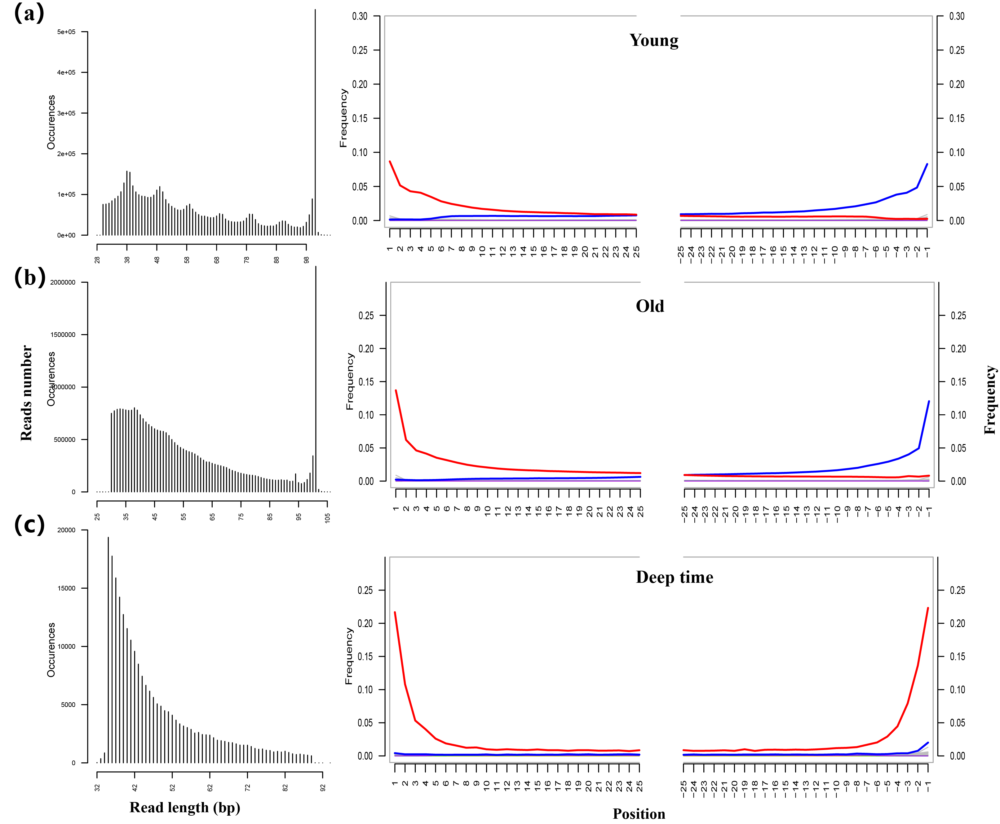
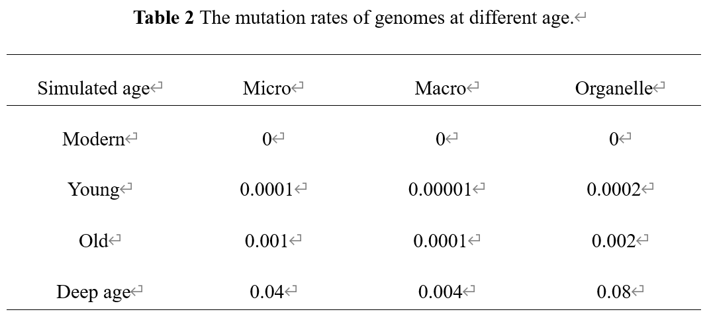

# Methods: simulation and database benchmarking

## Reference-genome panel

The community comprised seven biological categories totaling 600 RefSeq assemblies: 351 bacteria, 99 archaea, 50 fungi, 50 plants, 15 mammals, 15 other vertebrates and 20 invertebrates. The seven category-specific NCBI assembly summaries are retained separately. Only the execution inputs are consolidated into three accession lists: microbial (bacteria, archaea and fungi; n = 500), animal (mammals, other vertebrates and invertebrates; n = 50) and plant (n = 50). This three-way grouping is an implementation convenience and does not redefine the seven-category experimental design. Exact downloaded FASTA files, dates and checksums should be archived because NCBI records can change.

Following the original workflow, assemblies were selected by random sampling within each category-specific assembly summary. The reproducible implementation samples only records with an accession and usable FTP path, uses a recorded pseudorandom seed, and writes category-specific lists before merging them into the three execution lists. The bundled accession files are the realized panel used by the completed downstream simulation. Rerunning selection with another seed creates a new Truth600 panel and must be reported as such.

## Community construction

Thirty replicate communities were generated for each of four temporal conditions: modern, young (approximately 1,000 years BP), old (approximately 10,000 years BP) and deep time (approximately 40,000 years BP). Scripts draw per-genome fragment counts from 10--10,000. Animal nuclear and mitochondrial fractions are combined at 100:1; plant nuclear, chloroplast and mitochondrial fractions at 50:50:1. Microbial, animal and plant fractions are then merged.

## Fragment length and damage

Sequences were fragmented with Gargammel `fragSim`. Age-specific empirical length distributions are in `01_common_inputs/fragmentation/`. Young, old and deep-time reads were modified with Gargammel `deamSim` using the corresponding empirical misincorporation files in `01_common_inputs/Damage/` and the double-stranded-library model. Source profiles documented by the workflow represent a young Yana sample (766 BP), an old Yana sample (31,630 BP) and a deep-time femur sample (approximately 430 ka). The files, rather than rounded age labels, are the authoritative numerical inputs.

## Evolutionary substitutions

Mutation-Simulator was applied before damage simulation with `-titv 1`. Fractions encoded in the scripts are:

| Age | Microbial | Animal nuclear | Animal mitochondrial | Plant nuclear | Plant chloroplast | Plant mitochondrial |
|---|---:|---:|---:|---:|---:|---:|
| Modern | 0 | 0 | 0 | 0 | 0 | 0 |
| Young | 0.0001 | 0.00001 | 0.0002 | 0.00001 | 0.0002 | 0.08 |
| Old | 0.001 | 0.0001 | 0.002 | 0.0001 | 0.002 | 0.002 |
| Deep time | 0.04 | 0.004 | 0.08 | 0.004 | 0.08 | 0.08 |

These reproduce the code and must not be silently interpreted as per-year rates. Parameter changes constitute a new design.

## Read generation

Final FASTA fragments were converted to FASTQ with BBMap `reformat.sh`. Outputs are single-end; `double` in damage commands refers only to the library model. Read identifiers retain truth information. Each FASTQ should be accompanied by a checksum, read count and realized abundance/randomization record.

## Three database conditions

Reads were aligned with Bowtie2 and processed with SAMtools. DB1 contains Standard `nt+ref` candidates. Truth600 candidates are mapped independently. DB2 combines Standard and Truth600 candidates before assignment. DB3 excludes Truth600 accessions from Standard candidates. This avoids rebuilding large composite indexes while preserving the plus/minus comparison.

## Taxonomy and damage estimation

Candidate alignments are merged and compacted; LCA assignment uses accession-to-taxid mappings and one internally consistent NCBI taxonomy snapshot (`nodes.dmp` and `names.dmp`). metaDMG estimates taxon-level damage, followed by database-condition aggregation. Mixed taxonomy/index snapshots can produce missing or incorrect assignments and must not be used.

## Reporting

Record the Truth600 manifest and FASTA checksums, NCBI snapshot dates, software versions, random seeds, 30 realized compositions, cluster overrides, commands, and output checksums. Run `scripts/preflight.py`, Snakemake dry-runs and stage-specific lookup/overlap audits before production.
