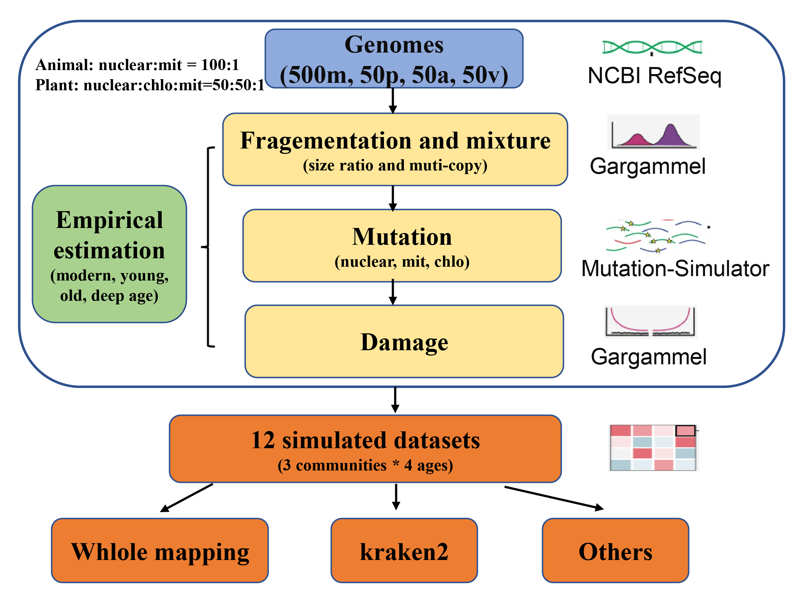

# aeDNA complete simulation and three-database benchmark pipeline

Publication-oriented release of the workflow used to simulate 600-genome environmental ancient-DNA (aeDNA) communities and benchmark taxonomic identification under three database conditions. The scientific order and parameter values are retained from the `sunruoqin` implementation in [YCWangLab/eBench](https://github.com/YCWangLab/eBench); the repository has been reorganized and documented for independent reproduction.



## What the workflow does

```text
600 RefSeq assemblies -> fragmentation -> substitutions and empirical damage
-> single-end FASTQ -> Bowtie2 -> DB1/DB2/DB3 -> LCA and metaDMG
```

| Stage | Directory | Purpose | Principal output |
|---|---|---|---|
| 1 | `01_simulation_to_single_end_fq/` | Download references and simulate four age classes | one single-end `<sample>.fq` per replicate and age |
| 2 | `02_three_database_preparation/` | Prepare Truth600 IDs and accession-to-taxonomy tables | audited Truth600 and DB2 lookup files |
| 3 | `03_bowtie2_mapping/` | Map reads and construct three logical database conditions | name-sorted BAM candidate sets |
| 4 | `04_merge_lca_metaDMG/` | Merge candidates, perform LCA and estimate damage | LCA, bdamage, dfit and aggregate tables |

DB1 is the existing Standard `nt+ref` search space. DB2 combines candidates obtained independently from Standard and Truth600 mappings. DB3 removes Truth600 accessions from Standard candidates. DB2 and DB3 therefore implement the experimental comparison without rebuilding very large physical indexes.

## Dataset design

Truth600 contains **seven biological categories**: 351 bacterial, 99 archaeal, 50 fungal, 50 plant, 15 mammalian, 15 other-vertebrate and 20 invertebrate assemblies. For execution only, their accession lists are consolidated into three processing groups: micro = bacteria + archaea + fungi (500), animals = mammals + other vertebrates + invertebrates (50), and plants (50). This consolidation does not reduce the seven-category experimental design. Thirty replicate communities are generated per age class. Per-genome fragment counts are sampled from 10--10,000. Animal nuclear:mitochondrial contributions are 100:1; plant nuclear:chloroplast:mitochondrial contributions are 50:50:1. See [METHODS.md](METHODS.md) for all parameters.

Stage 1 includes both reproducible random selection from the seven assembly summaries and the bundled realized selection used by the existing downstream data. See `00_reference_download/README.md`. New random selection requires an explicit seed and is written separately, so it cannot silently replace the published panel.

## Quick start

1. Copy this directory to a Linux/HPC filesystem. Large references and simulated reads are deliberately not tracked.
2. Follow [docs/PATHS_AND_CONFIGURATION.md](docs/PATHS_AND_CONFIGURATION.md) and replace site-specific `/online1/...` values.
3. Create the software environment from [environment.yml](environment.yml); install Gargammel and Mutation-Simulator separately if needed.
4. Run `python scripts/preflight.py`.
5. Follow the stage READMEs in order and dry-run each workflow with `snakemake -n -p -s <Snakefile>`.
6. Preserve the manifest, taxonomy snapshot, software versions, seeds, realized abundance tables and audit reports.

Bundled assembly summaries and empirical profiles are in `01_simulation_to_single_end_fq/01_common_inputs/`. The historical directory `02_morden` means **modern** and is retained to avoid breaking paths.

## Documentation

| File | Use |
|---|---|
| [METHODS.md](METHODS.md) | manuscript-ready methods and parameter table |
| [docs/PATHS_AND_CONFIGURATION.md](docs/PATHS_AND_CONFIGURATION.md) | paths a reproducer must change |
| [docs/CODE_GUIDE.md](docs/CODE_GUIDE.md) | purpose of every executable and support file |
| [docs/PROVENANCE.md](docs/PROVENANCE.md) | upstream commit provenance and selection rule |
| [docs/METADATA_AUDIT.md](docs/METADATA_AUDIT.md) | seven-category versus three-group accession audit |
| [docs/REPRODUCIBILITY_CHECKLIST.md](docs/REPRODUCIBILITY_CHECKLIST.md) | pre-run and publication checklist |
| [PIPELINE_MANIFEST.tsv](PIPELINE_MANIFEST.tsv) | machine-readable entry-point inventory |
| [GITHUB_UPLOAD.md](GITHUB_UPLOAD.md) | safe upload and post-upload verification steps |

## Interpretation notes

- Gargammel `deamSim ... double` is the double-stranded-library damage model, not paired-end sequencing.
- Final simulated files are single-end and Bowtie2 uses `-U`.
- Archive downloaded FASTA files and checksums because NCBI accessions can later change.
- SLURM resources are site settings; mutation values, empirical profiles, ratios and database membership are scientific parameters.

## Citation and licence

Code is GPL-3.0; see [LICENSE](LICENSE). Cite the final benchmark publication when available, Gargammel (Renaud et al., 2017; DOI `10.1093/bioinformatics/btw670`), Mutation-Simulator (Kuhl et al., 2021; DOI `10.1093/bioinformatics/btaa716`) and the software versions used.
